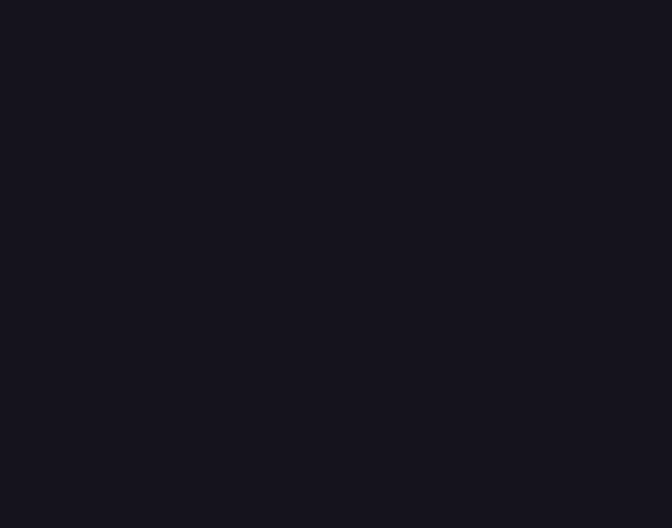

# PixelFX for Codex

Навык Codex для создания пиксельных игровых эффектов по описанию. Codex пишет или изменяет JavaScript, рендерит анимацию, проверяет кадры и экспортирует прозрачные спрайт-листы. В комплекте движок [PixelFX от Patch](https://github.com/patch-gg/pixelfx), 244 исходных эффекта и пример электрического взрыва.



## Установка

Понадобятся Codex и Node.js 18 или новее. Склонируйте или распакуйте репозиторий. Из его корня выполните в PowerShell:

```powershell
$skillPath = Join-Path ([Environment]::GetFolderPath('UserProfile')) '.agents/skills/pixelfx'
if (Test-Path -LiteralPath $skillPath) {
    throw "Навык уже существует: $skillPath"
}
New-Item -ItemType Directory -Path $skillPath -Force | Out-Null
Copy-Item -LiteralPath 'SKILL.md','agents','scripts','assets' -Destination $skillPath -Recurse
```

На macOS или Linux скопируйте те же четыре элемента в `~/.agents/skills/pixelfx/`. Если навык не появился в списке, перезапустите Codex.

## Использование в Codex

> Используй $pixelfx: сделай камень, который поднимается из земли, покрывается трещинами и разлетается. Экспортируй прозрачный атлас для Unity, 30 кадров/с.

Навык может взять эффект из каталога или написать новый. Для работы Codex создаёт отдельную копию движка. PNG, JSON и автономный HTML-просмотр рендерятся локально без установки пакетов npm. Для экспорта GIF или MP4 через CLI нужен FFmpeg.

## Использование из командной строки

Из корня репозитория:

```sh
node scripts/workspace.mjs ../pixelfx-work
cd ../pixelfx-work
node tools/list.mjs lightning
node tools/render.mjs arcane/prism-burst --sheet --html
node tools/check.mjs arcane/prism-burst
```

Результаты появятся в `records/arcane/prism-burst/`: кадры для просмотра, автономный HTML, прозрачный атлас PNG и JSON с размерами кадров, частотой и точкой привязки. При импорте в Unity задайте фильтрацию Point и нарежьте атлас по размеру кадра из `meta.pixelfx.frameSize`.

Подробнее: [инструкции навыка](SKILL.md) и [руководство по эффектам](assets/pixelfx/docs/AUTHORING.md).

## Авторство

Неофициальная адаптация PixelFX для Codex. Автор оригинального проекта — Patch. Сведения об авторах и заимствованиях сохранены в [LICENSE](LICENSE) и [NOTICE.md](NOTICE.md). Галерея использует системный моноширинный шрифт.
